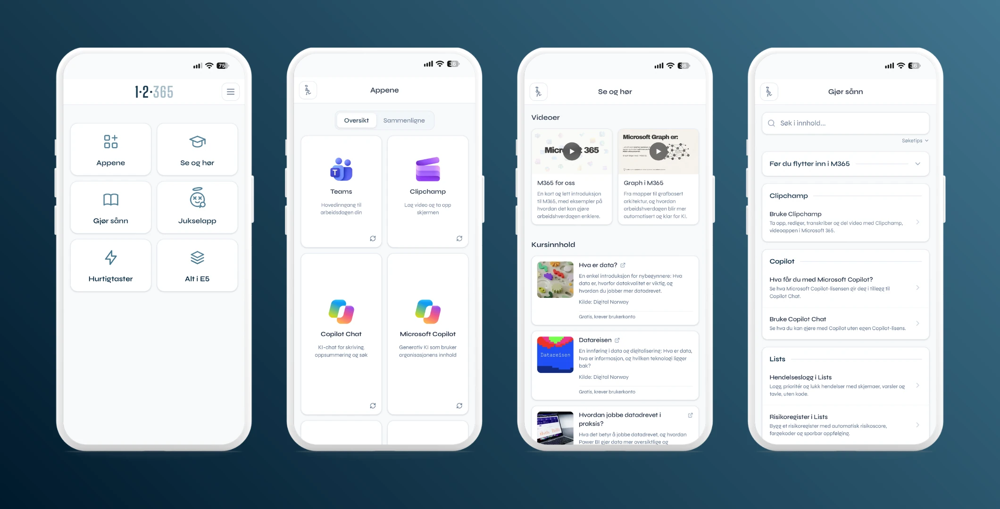

# 1-2-365

Jeg har laget appen **1-2-365** for å sette turbo på:

- min egen **læring og modning** i Microsoft 365-universet
- min evne til å **lære andre**
- **utfasing av dokumentfiler** så langt som mulig: Strukturerte data gjør digitalisering og KI billigere, raskere og enklere

**Du finner den her:** https://elzacka.github.io/12365/

Trykk på et bilde for å se det i full størrelse.

<p>
  <a href="docs/screenshots/oversikt-1.webp"></a>
  <a href="docs/screenshots/oversikt-2.webp"></a>
</p>

## Tech stack

React 19, TypeScript, Vite, Tailwind CSS, React Router, vite-plugin-pwa med Workbox, MiniSearch (søk) og Media Chrome (videospiller). Installerbar PWA på desktop og mobil.

## Komme i gang

```bash
npm install
npm run dev      # Lokal utvikling
npm run build    # Produksjonsbygg
npm run lint     # ESLint
npm test         # Tester (Vitest)
npm run lock     # Krypter skjult innhold (admin)
npm run ms-navn -- "Track Changes"   # Microsofts norske navn fra Office-appene på Mac
```

Push til `main` bygger og publiserer automatisk via GitHub Pages.

## Innhold

Redigerbart innhold ligger i `public/content/` (JSON). `OM-APPEN.md` og `PERSONVERN.md` i rotmappen vises i appen gjennom en innebygd markdown-renderer.

## Versjonering

[SemVer](https://semver.org/) – PATCH for innholdsoppdateringer og feilrettinger, MINOR for nye apper, nye veiledninger og ny funksjonalitet, MAJOR for endringer som bryter datastrukturen eller navigasjonen.

## Lisens

MIT – se [LICENSE](LICENSE).
